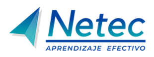

# PostgreSQL Advanced

## Plataforma de laboratorios

Bienvenido a la **plataforma de laboratorios** del curso **PostgreSQL Advanced**. Aquí podrás explorar diferentes tecnologías a través de prácticas guiadas. ¡Desarrolla tus habilidades y lleva tus conocimientos al siguiente nivel!.

## Lista de laboratorios

Cada uno de estos laboratorios están diseñados para ofrecerte una experiencia práctica. Haz clic en los enlaces para comenzar.

### - [Práctica 1. Instalación de PostgreSQL en Linux](./Capítulo1/README.md) 
- ⏱️ **Duración estimada**: 45 min.

### - [Práctica 2. Creación de índices B-tree.](./Capítulo2/README.md)
 - ⏱️ **Duración estimada**: 30 min.

### - [Práctica 3. Manejo de transacciones y MVCC.](./Capítulo3/README.md)
 - ⏱️**Duración estimada**: 25 min.

### - [Práctica 4. Realización de backups lógicos y físicos](./Capítulo4/README.md)
 - ⏱️**Duración estimada**: 30 min.

### - [Práctica 5. Replicación asíncrona y síncrona](./Capítulo5/README.md)
 - ⏱️**Duración estimada**: 30 min.
   
### - [Práctica 6. Gestión de usuarios y autenticación, acceso remoto y permisos.](./Capítulo6/README.md)
 - ⏱️**Duración estimada**: 30 min.
   
### - [Práctica 7. Configuración y monitoreo de la base de datos.](./Capítulo7/README.md)
 - ⏱️**Duración estimada**: 30 min.
   
### - [Práctica 8. Actualización de la versión mayor de PostgreSQL o upgrade y estadísticas extendidas.](./Capítulo8/README.md)
 - ⏱️**Duración estimada**: 30 min.
   
---

## 📬 **Contacto y más información**

Si tienes alguna pregunta o necesitas más detalles, no dudes en [contactarnos](mailto:soporte@netec.com). También puedes encontrar más recursos en nuestra [página](https://netec.com).

---

¡Gracias por visitar nuestra plataforma! No olvides revisar todos los laboratorios y comenzar tu viaje de aprendizaje hoy mismo.
